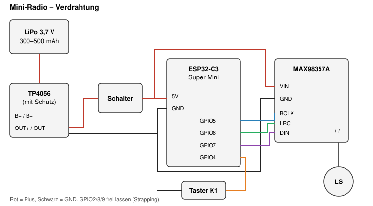

# Mini-Radio – McDonald's-Promo-Radio als WLAN-Lautsprecher

Umbau eines kleinen McDonald's-Promo-Radios (Aktion mit fest eingebranntem Song) zu einem
WLAN-Lautsprecher mit **ESP32-C3**, **MAX98357A** und **ESPHome**. Das Radio erscheint in
Home Assistant als Media Player und spielt Songs, TTS-Ansagen oder Webradio.



## Inhalt

1. [Was drin ist (Original)](#1-was-drin-ist-original)
2. [Teileliste](#2-teileliste)
3. [Gehäuse öffnen](#3-gehäuse-öffnen)
4. [Verdrahtung](#4-verdrahtung)
5. [Firmware flashen (ESPHome)](#5-firmware-flashen-esphome)
6. [Home Assistant einrichten](#6-home-assistant-einrichten)
7. [Einbau](#7-einbau)
8. [Grenzen & Tradeoffs](#8-grenzen--tradeoffs)
9. [Fehlersuche](#9-fehlersuche)

---

## 1. Was drin ist (Original)

| Bauteil | Beschreibung | Wiederverwenden? |
|---|---|---|
| Platine „TRITECH“ | 8-poliger OTP-Sound-Chip (U1), Transistor Q1, Taster K1 | Nein – Chip ist nicht programmierbar |
| Schiebeschalter (Rückseite) | ON/OFF | **Ja** – als Hauptschalter |
| Taster K1 | wird vom gelben Play-Knopf gedrückt | **Ja** – Play-Taste |
| Lautsprecher | ca. 20 mm, an S+/S− | **Ja** |
| Knopfzellen | 2–3× LR44 im Blechhalter | Nein – zu wenig Spannung/Kapazität |
| Zweiter „Lautsprecher“ | nur Attrappe | Platz für Akku oder zweiten Lautsprecher |

**Warum der Original-Chip raus muss:** Es ist ein One-Time-Programmable- bzw. Masken-ROM-Chip.
Der Song wird in der Fabrik einmalig geschrieben. Die Pads A–E sind Fertigungs-/Testpunkte,
keine nutzbare Programmierschnittstelle.

## 2. Teileliste

| Teil | Zweck | Hinweis |
|---|---|---|
| ESP32-C3 Super Mini | Steuerung, WLAN | ca. 22 × 18 mm, kein PSRAM |
| MAX98357A Breakout | I²S-DAC + Class-D-Verstärker (≈3 W) | treibt den Original-Lautsprecher direkt |
| LiPo 3,7 V, 300–500 mAh | Stromversorgung | flach, z. B. 402030 / 502030 |
| TP4056-Ladeboard **mit Schutz** (DW01) | Laden per USB-C, Tiefentladeschutz | Version mit 6 Pads (B+/B−/OUT+/OUT−) |
| Litze 0,14 mm², Schrumpfschlauch | Verdrahtung | |
| Optional: Heißkleber / doppelseitiges Klebeband | Fixieren im Gehäuse | |

**Werkzeug:** Lötkolben (feine Spitze), Seitenschneider, Plektrum/Spudger, Cutter, Multimeter.

## 3. Gehäuse öffnen

1. Alle sichtbaren Schrauben lösen (auch unter dem Griff und am Anhänger).
2. Front-Aufkleber abziehen – darunter ist **keine** Schraube.
3. Gelbe Lautsprecher-Ringe sind eingeklipst und können dran bleiben.
4. Die Gehäusehälften sind zusätzlich gesteckt und leicht verklebt: an der Naht mit Plektrum
   ansetzen und rundherum lösen. Kurz mit dem Föhn anwärmen hilft.
5. Platine, Lautsprecher und Batteriekontakte herausnehmen.

## 4. Verdrahtung

| Von | Nach | Hinweis |
|---|---|---|
| Akku + | TP4056 **B+** | |
| Akku − | TP4056 **B−** | |
| TP4056 **OUT+** | Schiebeschalter → ESP **5V** und MAX98357A **VIN** | Schalter trennt die Last |
| TP4056 **OUT−** | ESP **GND** und MAX98357A **GND** | gemeinsame Masse |
| ESP **GPIO5** | MAX98357A **BCLK** | |
| ESP **GPIO6** | MAX98357A **LRC** (LRCLK/WS) | |
| ESP **GPIO7** | MAX98357A **DIN** | |
| MAX98357A **+ / −** | Lautsprecher | **nicht** gegen GND schalten (Brückenausgang) |
| Taster K1 | ESP **GPIO4** ↔ **GND** | interner Pull-up |

**Warum diese Pins:** GPIO2, GPIO8 und GPIO9 sind beim C3 Strapping-Pins (Boot-Modus) und
GPIO8 hängt am Onboard-LED. GPIO4–7 sind unkritisch.

**Warum 5V-Pin statt 3V3:** Der LDO auf dem Super Mini macht aus 3,5–4,2 V saubere 3,3 V.
Direkt an 3V3 würde der volle Akku (4,2 V) den ESP überlasten.

**Lautsprecher-Gain:** Der MAX98357A hat ohne Beschaltung 9 dB. Bei Verzerrung den
**GAIN**-Pin über 100 kΩ an GND legen (= 15 dB) oder an VIN (= 6 dB) – ausprobieren.

## 5. Firmware flashen (ESPHome)

1. Repo klonen, `esphome/secrets.example.yaml` nach `esphome/secrets.yaml` kopieren und ausfüllen.
2. Einen API-Key erzeugen:
   ```bash
   openssl rand -base64 32
   ```
3. ESP per USB-C anschließen und flashen:
   ```bash
   cd esphome
   esphome run mini-radio.yaml
   ```
   Alternativ im ESPHome-Dashboard (HA-Add-on) die YAML einfügen und „Install → Plug into this computer“.
4. Falls der C3 nicht erkannt wird: **BOOT** gedrückt halten, **RESET** kurz drücken, BOOT loslassen.
5. Spätere Updates laufen per OTA über WLAN.

### WLAN-Profil (`esphome/wifi.yaml`)

Die WLAN-Einstellungen liegen in einer eigenen Datei, die `mini-radio.yaml` als Package einbindet.
So bleibt die Haupt-Config unverändert, wenn sich nur das Netz ändert.

- **Zwei Netze**: Haupt-WLAN plus ein zweites (z. B. Handy-Hotspot für unterwegs). Das Radio nimmt das stärkste erreichbare.
- **Fallback-Hotspot**: Findet es kein bekanntes Netz, öffnet es nach 1 Minute das WLAN **„Mini-Radio-Setup“**.
- **Captive Portal**: Mit dem Handy in „Mini-Radio-Setup“ einwählen, `http://192.168.4.1` öffnen und neues WLAN eintragen – ohne neu zu flashen.

Die Zugangsdaten selbst stehen nur in `secrets.yaml`.

### Webinterface

Nach dem Flashen unter `http://mini-radio.local` (Benutzer `admin`, Passwort aus `web_password`):
Status, Lautstärke, Play-Taste, Live-Logs und Firmware-Upload.

- `local: true` legt JS/CSS in den Flash – funktioniert ohne Internet.
- Der C3 hat kein PSRAM: Webserver und Audio-Puffer teilen sich den RAM. Hakt die Wiedergabe,
  den `web_server:`-Block auskommentieren – Home Assistant reicht zur Steuerung.
- Songs hochladen/abspielen geht nicht über das Webinterface, sondern über Home Assistant.

## 6. Home Assistant einrichten

1. Gerät erscheint unter *Einstellungen → Geräte & Dienste* als „Mini-Radio“ → hinzufügen, API-Key eingeben.
2. Es gibt dann:
   - `media_player.mini_radio_radio` – Ziel für Musik, TTS, Webradio
   - `binary_sensor.mini_radio_play_taste` – die gelbe Taste
3. Automation aus [`homeassistant/automation-play-taste.yaml`](homeassistant/automation-play-taste.yaml)
   importieren: Tastendruck spielt eine Datei aus der HA-Mediathek ab.
4. Eigene MP3s unter `/media/mini-radio/` ablegen (Medien-Browser in HA).

**Warum HA die Umrechnung macht:** Der C3 hat kein PSRAM. Deshalb ist die Pipeline auf
16 kHz/mono/WAV gestellt; HA wandelt MP3 & Streams per ffmpeg-Proxy um, der ESP muss nichts dekodieren.

## 7. Einbau

- Original-Platine, Knopfzellen-Halter und störende Stege mit dem Seitenschneider entfernen.
- ESP und MAX98357A in die Mitte (dort, wo die Platine saß), Akku in die Attrappen-Lautsprecherkammer.
- USB-C-Buchse des TP4056 (oder des ESP) an eine Stelle legen, wo ihr eine Öffnung ins Gehäuse feilen könnt.
- Lautsprecher wieder in seine Kammer, ggf. mit Heißkleber am Rand fixieren.
- Vor dem Zuschrauben testen. Keine Kabel unter die Schraubdome klemmen.

## 8. Grenzen & Tradeoffs

| Thema | Was das bedeutet |
|---|---|
| Kein PSRAM (C3) | Kurze Sounds/TTS laufen sauber, lange Streams können bei schwachem WLAN aussetzen. Upgrade-Pfad: ESP32-S3 Super Mini (N4R2), Pins fast gleich. |
| Kein Bluetooth-Audio | C3/S3 können nur BLE, kein A2DP. Für Handy-Streaming per BT bräuchte es einen klassischen ESP32. |
| Akkulaufzeit | Mit Dauer-WLAN wenige Stunden. Für längere Standzeit Deep Sleep mit Taster als Wake-up ergänzen. |
| Klang | 20-mm-Lautsprecher – laut genug für Ansagen und Kinderspaß, kein HiFi. |

## 9. Fehlersuche

| Symptom | Ursache / Lösung |
|---|---|
| ESP bootet nicht / Bootloop | Pin an GPIO2/8/9 belegt? Spannung am 5V-Pin prüfen (≥ 3,5 V). |
| Kein Ton | BCLK/LRC vertauscht? MAX98357A **SD**-Pin nicht auf GND ziehen (sonst Shutdown). |
| Rauschen / Knacken | Masse gemeinsam? Kurze Kabel, Gain reduzieren. |
| Aussetzer bei Streams | `buffer_size` leicht erhöhen, WLAN-Signal prüfen, oder auf S3 wechseln. |
| Radio nicht im WLAN | Nach 1 Min. Hotspot „Mini-Radio-Setup“ suchen, über `192.168.4.1` neu einrichten. |
| `mini-radio.local` nicht erreichbar | mDNS im Netz blockiert → IP aus Router oder HA nehmen. |
| Compile-Fehler bei Keys | ESPHome-Version prüfen – Optionen des `speaker`-Media-Players haben sich zwischen Versionen geändert. |

## Lizenz

MIT – siehe [LICENSE](LICENSE).
